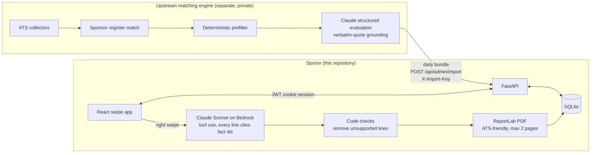

# Sponsr

Evidence-grounded job matching: swipe through engineering roles at verified visa sponsors, and a right swipe produces a fact-checked CV tailored to that role.

Live app: https://sponsr.codetrend.com (private beta, sign-in required; the sign-in page explains the full pipeline)

## Overview

Sponsr is the user-facing half of a two-part system. An upstream matching engine (not in this repository) collects postings, confirms that each employer holds a visa sponsor licence and that the posting itself offers sponsorship, and evaluates fit against a candidate's verified profile. Once a day it pushes the ranked result to Sponsr as a bundle.

Sponsr turns that bundle into a swipe deck:

- **Discover**: a card deck of verified roles, best fit first. Each card shows the fit score, strengths and gaps, the sponsor register entry, and the verbatim sponsorship quote from the posting. Swipe or use the arrow keys; undo is supported.
- **Right swipe**: Claude Sonnet on Amazon Bedrock writes a CV for that role from the candidate's verified facts only. Code checks every line before an ATS-friendly PDF is rendered.
- **Applications**: generated CVs with status (writing, ready, failed, applied), an in-app PDF preview, download, retry, and mark-as-applied.
- **Profile**: the verified profile the CVs are built from (roles, facts, skills), with an optional photo.
- **MCP server**: the same capabilities exposed as a remote MCP server (`/mcp`, streamable HTTP) with 7 tools (find sponsored jobs, job details, create a tailored CV, show a CV, open the job post, my CVs, my profile). It works as a custom connector in claude.ai and ChatGPT through OAuth 2.1 with a Sponsr sign-in page; the CV comes back in the chat with a PDF link.
- **Prompt caching**: the CV prompt puts the stable parts first (tool schema, instructions, the candidate's verified facts, marked for caching) and the job posting last, so a burst of CVs reads most of the prompt from cache. Measured: the second CV in a session was 77% cached and cost $0.033 instead of $0.050. Token use, cache hits and cost are stored with each application and shown in the app and in the MCP result.
- **Live applications list**: the Applications page polls every 8 seconds (every 3 while a CV is being written) and on tab focus, so CVs requested from Claude or ChatGPT appear on their own.

No model call happens on import. Claude is called only when a user asks for a CV.

## Architecture



### Upstream pipeline (summary)

The matching engine is a separate codebase. Its contract with Sponsr is the bundle format in `data/sample-bundle.json` and the import endpoint. In short, it:

1. Collects postings from public applicant-tracking systems (Greenhouse, Lever, Ashby, Workday, SmartRecruiters).
2. Matches every employer against the official UK and Dutch sponsor registers, using normalised and fuzzy legal-name matching.
3. Applies a deterministic prefilter in code before any model call, so model cost scales with real candidates rather than raw postings.
4. Evaluates the remaining roles with Claude using structured output. A sponsorship claim only counts if code finds its verbatim quote in the posting. The evaluation model was chosen by comparing two Claude models on 278 real cases, balancing quality against cost.
5. Pushes the ranked set to Sponsr once a day.

## Grounding and safety

CV generation is designed so the model cannot introduce claims the candidate has not verified. The logic is in `backend/app/cv/generate.py` and `backend/app/cv/render.py`.

- **Fact ids on every line.** The model returns the CV through a tool with a JSON schema. Every summary sentence and every bullet carries the ids of the verified facts it is based on.
- **Unsupported lines are removed in code.** A line that cites no existing fact is dropped. A line containing a number that does not appear in its cited facts is dropped. Experience blocks that reference an unknown role are dropped.
- **Skills must appear in the facts.** Each listed skill is checked word by word against the facts and declared skills; anything else is removed.
- **Employer, title and dates are never written by the model.** The PDF takes them from the verified role records. The model only selects and orders roles and writes bullets.
- **Length is enforced in code.** At most 18 bullets; the renderer then trims the least relevant bullet until the PDF fits two pages.
- **Every removal is recorded.** A note for each removed or trimmed line is stored with the application and returned by the API, so it is auditable what the checks changed.
- **Cost is tracked per CV** from token usage.

Access controls:

- Accounts are created by an administrator (`app.cli add-user`); passwords are hashed with bcrypt.
- Sessions are HS256 JWTs in an HttpOnly, SameSite=Lax cookie (Secure when served over HTTPS).
- The import endpoint requires a shared key, compared in constant time, and is disabled when no key is configured. An empty job list never wipes the existing deck.
- MCP OAuth codes and tokens are stored only as SHA-256 hashes; PKCE is enforced by the MCP SDK.

## Tech stack

| Layer | Technology |
| --- | --- |
| Frontend | React 18, TypeScript, Vite, Framer Motion (swipe deck), pdf.js (CV preview), React Router |
| Backend | Python 3.11, FastAPI, SQLAlchemy 2, Pydantic Settings |
| Storage | SQLite by default (any SQLAlchemy URL via `SPONSR_DATABASE_URL`) |
| AI | Claude Sonnet on Amazon Bedrock (Anthropic SDK), tool use with a JSON schema |
| Documents | ReportLab (PDF rendering), pypdf (page count check) |
| Auth | bcrypt, PyJWT (cookie sessions), OAuth 2.1 for the MCP server |
| Integration | MCP Python SDK (streamable HTTP) |
| Tests | pytest with FastAPI TestClient (Claude stubbed) |

## Repository structure

```
backend/
  app/
    main.py          FastAPI app: API routes, OAuth routes, MCP server mount
    api.py           sign-in, feed, swipe, undo, applications, CV PDF, profile
    auth.py          bcrypt passwords, JWT cookie sessions
    bundle.py        applies an imported bundle (jobs + verified profile)
    cli.py           add-user, import-bundle
    config.py        settings (SPONSR_ environment variables)
    db.py, models.py SQLAlchemy engine and models
    mcp_app.py       remote MCP server tools
    oauth.py         OAuth 2.1 provider and sign-in page for the MCP server
    cv/
      generate.py    Claude call, tool schema, grounding checks
      render.py      ATS-friendly PDF, two-page limit
  tests/test_api.py  end-to-end API flow and grounding checks
  .env.example
  requirements.txt
frontend/
  src/               React app (pages, swipe deck, cards, PDF preview)
  public/            favicon, pdf.js worker
tools/
  export_from_jobscout.py  import contract with the upstream matching engine (writes a bundle to a file)
  fetch_logos.py           fetches employer logos and brand colours for the cards
data/
  sample-bundle.json       synthetic bundle (fictional candidate and companies)
```

## Getting started

### Prerequisites

- Python 3.11+
- Node.js 20+
- For CV generation: AWS credentials with Amazon Bedrock access to a Claude Sonnet model. Everything else (import, feed, swiping, tests) runs without AWS.

### Backend

```bash
cd backend
python -m venv .venv
source .venv/bin/activate          # Windows: .venv\Scripts\activate
pip install -r requirements.txt
cp .env.example .env               # then set SPONSR_JWT_SECRET at minimum

python -m app.cli add-user demo demo-pass
python -m app.cli import-bundle ../data/sample-bundle.json demo

uvicorn app.main:app --port 5090 --reload
```

The import loads three fictional roles and the profile of a fictional candidate. Run the tests with `pytest`.

### Frontend

```bash
cd frontend
npm install
npm run dev                        # http://localhost:5190, proxies /api to :5090
```

Sign in as `demo` / `demo-pass`.

### Importing bundles

- **From a file:** `python -m app.cli import-bundle path/to/bundle.json <username>`. The bundle becomes the active job set; jobs no longer present are retired, and swipes are kept by upstream job id so a swiped job never returns.
- **Over HTTP:** set `SPONSR_IMPORT_KEY` and `SPONSR_IMPORT_USER`, then `POST /api/admin/import` with the bundle as JSON and the header `X-Import-Key`. This is how the upstream engine pushes its daily update.

### Employer logos (optional)

Cards fall back to a coloured monogram. To use real logos, create `data/logo_domains.json` (`{"Company name": "company.com"}`) and run `python tools/fetch_logos.py` with the backend environment; it writes `frontend/public/logos/` and `data/logos.json`, which the next import picks up.

## Status

Running in a private beta at https://sponsr.codetrend.com with a daily feed from the upstream engine. Sponsorship coverage is the UK and the Netherlands. The upstream matching engine is not open source; this repository contains the application and the import contract.

## Author

Built by Efraim Hernandez · https://efraprojects.com

Efraim is a solutions architect with 17+ years of enterprise experience, building applied AI systems.
